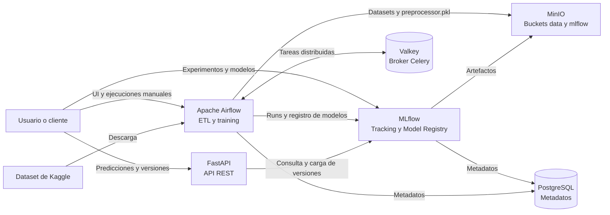
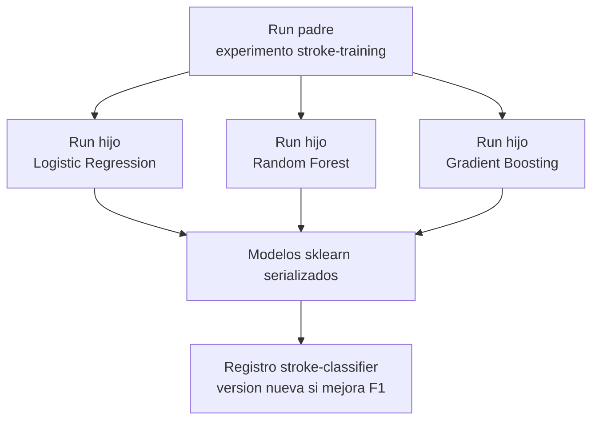
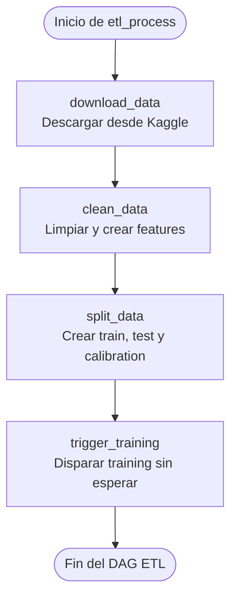
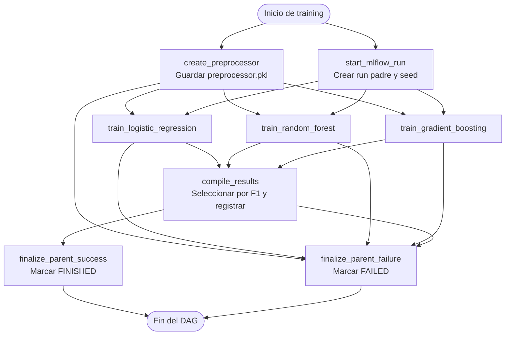
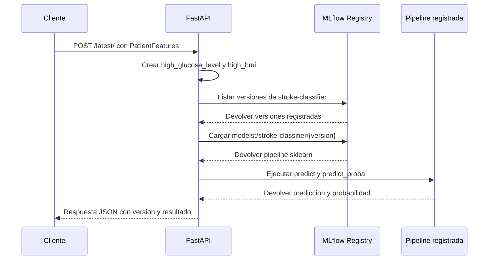

# Plataforma MLOps

## Descripcion general

La plataforma implementa un flujo completo para descargar y preparar datos,
entrenar modelos de clasificacion, registrar los resultados en MLflow y servir
predicciones mediante una API REST. El sistema esta compuesto por:

- Apache Airflow para orquestar el ETL y el entrenamiento.
- MLflow para registrar experimentos, metricas, artefactos y versiones de
  modelos.
- FastAPI para exponer predicciones y consultar las versiones registradas.
- MinIO como almacenamiento de objetos compatible con S3.
- PostgreSQL para los metadatos persistentes de Airflow y MLflow.
- Valkey como broker de mensajes de Airflow con `CeleryExecutor`.

La configuracion de Docker Compose esta orientada al desarrollo local y no es
una configuracion de produccion.

## Arquitectura



### Servicios e interfaces

- **FastAPI:** API REST, documentacion OpenAPI y Swagger UI en `/docs`.
- **MLflow:** interfaz web para experimentos, runs, metricas, artefactos y
  versiones registradas.
- **Airflow:** interfaz web para observar DAGs, logs y ejecuciones manuales.
- **MinIO:** interfaz web para inspeccionar buckets y objetos.
- **PostgreSQL:** metadatos de Airflow y MLflow, en las bases `airflow` y
  `mlflow_db`.
- **Valkey:** broker interno para las tareas distribuidas de Airflow.

Con la configuracion del archivo `.env`, las interfaces se encuentran en:

| Servicio | URL |
| --- | --- |
| Airflow | `http://localhost:8080` |
| MLflow | `http://localhost:5001` |
| MinIO Console | `http://localhost:9001` |
| Frontend | `http://localhost:8800/` |
| FastAPI | `http://localhost:8800` |
| Swagger UI | `http://localhost:8800/docs` |

El puerto interno de MLflow es `5000`; el archivo `.env` lo publica como
`5001` en el host. Los puertos pueden modificarse mediante las variables de
entorno correspondientes.

## FastAPI

FastAPI sirve el modelo registrado con el nombre `stroke-classifier`. Al
recibir un paciente, construye un `DataFrame`, agrega las features derivadas
`high_glucose_level` y `high_bmi`, carga la version solicitada desde MLflow y
ejecuta la pipeline completa del modelo. La pipeline registrada contiene el
preprocesamiento y el clasificador.

Los modelos se almacenan en memoria por version despues de su primera carga.
Esto evita volver a descargar el mismo artefacto en cada solicitud del proceso
de FastAPI.

### Endpoints

| Metodo | Endpoint | Descripcion |
| --- | --- | --- |
| `GET` | `/` | Sirve el frontend HTML (`static/index.html`) para consultar versiones y predecir desde un formulario. No figura en Swagger. |
| `GET` | `/health` | Indica que el proceso de la API esta disponible. Lo usa el healthcheck de Docker Compose. |
| `GET` | `/versions/` | Lista las versiones registradas, sus runs, estado, fecha de creacion y tags. |
| `POST` | `/latest/` | Predice con la version numericamente mas alta de `stroke-classifier`. |
| `POST` | `/versions/{version}/` | Predice con una version especifica del modelo. |

El endpoint `latest` obtiene todas las versiones registradas y selecciona la
de mayor numero. Si no existen versiones, o si la version solicitada no
existe, la API responde con HTTP 404.

### Esquema de entrada

Los endpoints de prediccion reciben directamente un objeto JSON con los
siguientes campos:

| Campo | Tipo | Valores o descripcion |
| --- | --- | --- |
| `gender` | string | `Male`, `Female`, `Other` |
| `age` | float | Edad |
| `hypertension` | int | Indicador 0/1 |
| `heart_disease` | int | Indicador 0/1 |
| `ever_married` | string | `Yes`, `No` |
| `work_type` | string | `children`, `Govt_job`, `Never_worked`, `Private`, `Self-employed` |
| `Residence_type` | string | `Urban`, `Rural` |
| `avg_glucose_level` | float | Nivel promedio de glucosa |
| `bmi` | float | Indice de masa corporal |
| `smoking_status` | string | `formerly smoked`, `never smoked`, `smokes`, `Unknown` |

La API calcula las features derivadas de la misma forma que el ETL:

- `high_glucose_level` vale `1` cuando `avg_glucose_level > 126`.
- `high_bmi` vale `1` cuando `bmi > 30`.

Ejemplo de estado de la API:

```bash
curl -X GET "http://localhost:8800/health"
```

Respuesta:

```json
{"status":"ok"}
```

Ejemplo de listado de versiones:

```bash
curl -X GET "http://localhost:8800/versions/"
```

Ejemplo de prediccion con la ultima version registrada:

```bash
curl -X POST "http://localhost:8800/latest/" \
  -H "Content-Type: application/json" \
  -d '{
    "gender": "Female",
    "age": 67.0,
    "hypertension": 0,
    "heart_disease": 1,
    "ever_married": "Yes",
    "work_type": "Private",
    "Residence_type": "Urban",
    "avg_glucose_level": 228.69,
    "bmi": 36.6,
    "smoking_status": "formerly smoked"
  }'
```

Respuesta de prediccion:

```json
{
  "version": "3",
  "prediction": 0,
  "probability": 0.0842
}
```

Para solicitar una version concreta se reemplaza `latest` por el numero de
version:

```bash
curl -X POST "http://localhost:8800/versions/3/" \
  -H "Content-Type: application/json" \
  -d '{
    "gender": "Female",
    "age": 67.0,
    "hypertension": 0,
    "heart_disease": 1,
    "ever_married": "Yes",
    "work_type": "Private",
    "Residence_type": "Urban",
    "avg_glucose_level": 228.69,
    "bmi": 36.6,
    "smoking_status": "formerly smoked"
  }'
```

La documentacion interactiva completa esta disponible en
`http://localhost:8800/docs`.

### Frontend

FastAPI sirve en `http://localhost:8800/` una pagina HTML simple,
`dockerfiles/fastapi/static/index.html`, que consume la misma API:

- **Estado:** al cargar consulta `/health` y muestra si la API responde.
- **Selector de version:** se completa con `/versions/` e incluye la opcion
  "Ultima" y cada version registrada con su tipo de modelo y F1.
- **Formulario:** contiene los diez campos del esquema de entrada, con
  listas desplegables para los valores categoricos e indicadores.
- **Resultado:** envia el formulario a `POST /latest/` o a
  `POST /versions/{version}/` y muestra la version utilizada, la prediccion y
  la probabilidad, o el error devuelto por la API.

Como la pagina y la API comparten origen, no se requiere configurar CORS.

## MLflow

MLflow centraliza el seguimiento del experimento `stroke-training`, el
almacenamiento de artefactos y el registro del modelo. Todas las versiones se
registran bajo un unico nombre:

```text
stroke-classifier
```

En cada ejecucion, `compile_results` selecciona el candidato con mayor F1
sobre el conjunto de prueba y lo compara con el F1 de la version numericamente
mas alta ya registrada. Se registra una nueva version solamente cuando:

- no existe ninguna version anterior; o
- el F1 del candidato es estrictamente mayor que el F1 de la ultima version.

Cuando el candidato no supera la version actual, la ejecucion queda registrada
en MLflow, pero no crea una nueva version del modelo.

Las versiones registradas reciben estos tags:

| Tag | Contenido |
| --- | --- |
| `model_type` | Familia del modelo seleccionada |
| `f1` | F1 del modelo, formateado con cuatro decimales |

### Runs de entrenamiento

Cada ejecucion de `training` crea un run padre y un run hijo por cada familia
de modelo:



El run padre registra:

- El parametro `random_seed`, generado aleatoriamente para cada ejecucion.
- La metrica `best_f1` del mejor candidato.
- El tag `selected_model` con la familia seleccionada.
- El estado final `FINISHED` o `FAILED`.

Cada run hijo registra:

| Categoria | Datos |
| --- | --- |
| Tags | `mlflow.runName`, `mlflow.parentRunId`, `model_type` |
| Parametros | Parametros configurados del estimador, nombre del estimador y parametros `best_*` de la busqueda |
| Metricas | `cv_f1`, `f1`, `recall`, `precision`, `balanced_accuracy`, `roc_auc`, `threshold` |
| Artefactos | Mejor modelo sklearn, serializado con CloudPickle bajo el path del estimador |

El modelo registrado conserva la referencia al run hijo de origen, su URI de
artefacto y su `model_id` de MLflow.

## Airflow y orquestacion

Airflow ejecuta dos DAGs:

- `etl_process`: se ejecuta cada 15 dias a partir del 1 de enero de 2026.
- `training`: no tiene schedule propio; se ejecuta cuando lo dispara ETL o
  manualmente.

### DAG `etl_process`

El DAG descarga el dataset de stroke, lo limpia, genera features y crea
los splits de entrenamiento y evaluacion.



Las tareas realizan lo siguiente:

1. **Descarga:** obtiene la version mas reciente de
   `fedesoriano/stroke-prediction-dataset` mediante `kagglehub` y guarda
   `healthcare-dataset-stroke-data.csv` en
   `s3://data/raw/healthcare-dataset-stroke-data.csv`.
2. **Limpieza:** completa los valores faltantes de `bmi` con la mediana,
   descarta filas con `bmi > 60`, elimina `id` y crea `high_glucose_level` y
   `high_bmi`. Guarda el resultado en
   `s3://data/clean/healthcare-dataset-stroke-data.csv`.
3. **Particionado:** separa `stroke` de las features y realiza divisiones para obtener aproximadamente 70% de entrenamiento, 15% de
   prueba y 15% de calibracion.
4. **Almacenamiento:** guarda los CSV sin preprocesar en:
   `s3://data/splits/healthcare-dataset-stroke-data-train.csv`,
   `s3://data/splits/healthcare-dataset-stroke-data-test.csv` y
   `s3://data/splits/healthcare-dataset-stroke-data-calibration.csv`.
5. **Disparo:** `TriggerDagRunOperator` inicia `training`.

### DAG `training`

El DAG crea en paralelo el pipeline de preprocesamiento y el run padre de
MLflow. Luego ejecuta tres tareas de entrenamiento en paralelo. Cada tarea
lee los mismos splits de train y test, carga el preprocesador almacenado y
construye una pipeline completa de preprocesamiento y modelo.



Las familias evaluadas son:

- Logistic Regression, con busqueda de `C` en escala logaritmica.
- Random Forest, con busqueda de cantidad de arboles, profundidad y cantidad
  de features.
- Gradient Boosting, con busqueda de cantidad de estimadores, learning rate y
  profundidad.

Cada entrenamiento utiliza:

- `GridSearchCV` de cinco folds con scoring F1.
- `SMOTE` dentro de la pipeline balanceada.
- `TunedThresholdClassifierCV` de tres folds, con scoring F1 y 100 umbrales.
- Evaluacion sobre el conjunto de prueba con F1, recall, precision, balanced
  accuracy y ROC AUC.

El umbral aprendido se utiliza al llamar `predict()` y tambien se registra como
la metrica `threshold`.

### Pipeline de preprocesamiento

El preprocesamiento no es una tarea del ETL ni se guarda como conjuntos de
datos transformados. `create_preprocessor` construye una pipeline y la guarda
como un objeto joblib en:

```text
s3://data/pipelines/preprocessor.pkl
```

La pipeline contiene:

- `OrdinalEncoder` para `ever_married`.
- `CountFrequencyEncoder` para `gender`, `smoking_status`, `work_type` y
  `Residence_type`.
- Passthrough para las columnas restantes.
- `StandardScaler` para el resultado.

Cada tarea `train_model` carga ese objeto, lo incluye en la pipeline externa
del modelo y lo ajusta junto con la busqueda de hiperparametros. El modelo
serializado y registrado contiene, por lo tanto, el preprocesamiento ajustado,
SMOTE, el clasificador y el ajuste de umbral. En inferencia se pueden enviar
las features con sus valores originales y la pipeline interna realiza las
transformaciones necesarias.

## Flujo de prediccion



Para una version fija, el cliente utiliza `/versions/{version}/` y se omite la
seleccion de la version mas alta.
